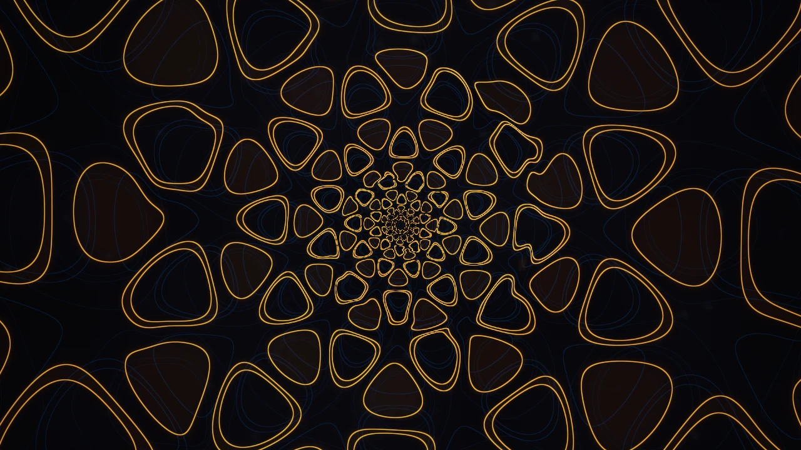

# Eigengrau — the eye within

[Watch the form cycle](../assets/eigengrau_motion.webp). The preview runs at
240 BPM so that all four forms fit in 16 seconds. At normal tempos each form
lasts a 16-beat phrase.

Close your eyes in the dark and the visual system keeps drawing. The grey you
see is *Eigengrau*, the intrinsic light of the eye. Under pressure, migraine,
flicker or drugs that darkness organises into a small family of geometries.
Heinrich Klüver catalogued them in the 1920s: **tunnels, spirals, lattices and
cobwebs**. They are the same in every observer because they are a property of
the visual cortex, not of any image.

This shader draws those form constants. Its subject is vision itself, rather
than anything you could point a camera at.

## How it works

1. **Cortex.** Activity is a set of standing and travelling waves on the
   primary visual cortex (V1). The waves are Bressloff–Cowan planforms in
   four symmetry classes: rolls, rings with spokes, a hexagonal triad, and
   shift-twist lace. A complex orientation field adds hypercolumn structure.
   Its zeros are *pinwheels*: local defects where the waves fork and rejoin.
2. **Retinocortical map.** Cortex coordinates are mapped back to the visual
   field through the inverse of the eye's log-polar projection,
   `u = ln(r)`, `v = θ`. Straight stripes on the cortex become rings, spokes
   and spirals in the eye. A flat hexagonal lattice becomes the honeycomb
   funnel. All azimuthal harmonics are integers, so the map has no seam.
3. **Perception.** Contours glow like thin phosphor traces on near-black.
   Each form has its own colour: violet tunnel, jade spiral, amber lattice,
   rose lace. Two dim, complementary echoes of the recent past drift behind
   the present pattern. In silence the field relaxes into Eigengrau, with
   sparse rod-noise phosphenes and a barely visible shadow of the retinal
   blood vessels.

Physiology is the inspiration here, not a validated simulation of an observer.

## Music and input

| Input | Effect |
|---|---|
| Tempo (`iBPM`) | The form advances once per 16-beat phrase and morphs during the final bar. |
| Spectral brightness | Leans the cycle: bright mixes toward lattice and lace, dark mixes toward tunnel and spiral. |
| Bass | A small beat push to the wave speed and to excitability. |
| Mids | Speed of the cortical waves. |
| Treble | Births of local pinwheel dislocations. |
| Loudness | Excitability. Silence returns to Eigengrau. A slow 11-second breath keeps steady music from filling the screen. |
| Mouse | Gaze: the field drifts slightly toward the pointer. |
| Click | Pressure phosphene, like pressing on a closed eyelid. Defects flood the field and fade over about six seconds. |

Music changes the *organisation* of the pattern: which symmetry dominates,
how fast it travels, and where it breaks. It does more than change brightness.

## Source layout

`shaders/eigengrau.wgsl` is **generated**. Edit the parts in
`shaders/eigengrau_parts/`, then run `check.sh --install`.

| File | Role |
|---|---|
| `cortex.wgsl` | Planforms, retinocortical map, pinwheels. `cortex(uv, t, org) -> (activity, orientation, defect, edge)` |
| `perception.wgsl` | Field to linear colour: phosphor contours, echoes, Eigengrau, phosphenes, vessels. `perceive(uv, t, org, bands) -> rgb` |
| `conductor.wgsl` | The only reader of uniforms. Turns audio, tempo and mouse into `org`, and performs the sRGB encode and dither. |
| `check.sh` | Assembles the parts with the vibe preamble and validates the result with `naga`. Missing parts are replaced by stubs. |
| `render.py` | Offscreen wgpu renderer with fake audio: frames, contact sheets and animated webp. |

`org` is `(form phase mod 4, wave speed, defect density, excitability)`. Each
pixel evaluates the cortex three times, for the present and two echoes.

Created jointly by three agents: Gemini (cortex), Codex (perception) and
Claude (conductor and integration).
